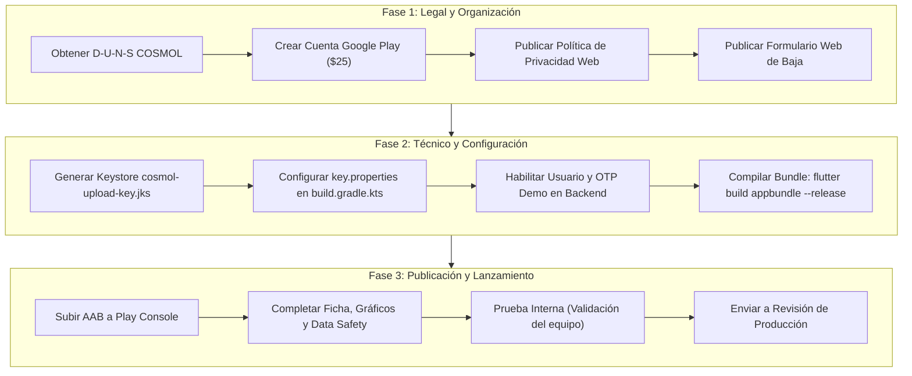

# Guía y Requerimientos de Publicación en Google Play Store — COSMOL RL

> **Documento Técnico y Normativo**  
> **Proyecto:** App de Socios COSMOL RL  
> **Destino:** Google Play Console / Google Play Store  
> **Última actualización:** 2026-10-12  

---

## 1. Resumen Ejecutivo

Este documento establece la totalidad de requerimientos técnicos, normativos, de seguridad, de diseño y de mantenimiento necesarios para publicar y mantener en producción la aplicación oficial de **COSMOL R.L.** (Cooperativa de Servicios Públicos Montero R.L.) en **Google Play Store**.

La plataforma está desarrollada en **Flutter 3.x** consumiendo un BFF asíncrono en **FastAPI**, integrando servicios públicos de agua potable y alcantarillado, descarga de facturas en PDF, autenticación OTP (WhatsApp/SMS), biometría y pagos por QR interbancario.

---

## 2. Requisitos de la Cuenta de Google Play Console

### 2.1 Tipo de Cuenta: Organización (Empresa / Cooperativa)
> [!IMPORTANT]
> **Es mandatorio registrar la cuenta como Organización** a nombre de **COSMOL R.L.** y no como cuenta personal/individual.

| Criterio | Cuenta de Organización (COSMOL R.L.) | Cuenta Personal (Desarrollador Individual) |
|---|---|---|
| **Período de Pruebas Obligatorio** | **Ninguno.** Puede pasar directamente a producción tras la revisión estándar de Google. | **Obligatorio:** Mínimo 20 evaluadores activos probando en prueba cerrada durante 14 días ininterrumpidos. |
| **Riesgo de Rechazo Inicial** | Bajo (acreditación corporativa formal). | Muy alto (Google rechaza frecuentemente si los 20 testers no interactúan a diario). |
| **Identidad en la Tienda** | Muestra a **COSMOL R.L.** como desarrollador oficial. | Muestra el nombre de una persona particular. |
| **Costo de Registro** | $us 25 (pago único con tarjeta internacional). | $us 25 (pago único). |

### 2.2 Requisitos Previos para el Alta de la Organización
1. **Número D-U-N-S (Dun & Bradstreet):**
   * Google exige un código D-U-N-S válido donde el nombre legal y la dirección física coincidan exactamente con la personería jurídica de COSMOL R.L.
   * Si la cooperativa no cuenta con uno, debe tramitarse en [Dun & Bradstreet](https://www.dnb.com/duns-number.html). El trámite gratuito puede tardar entre 5 y 15 días hábiles.
2. **Documentación Legal de Respaldo:**
   * Certificado de Personería Jurídica / Registro Cooperativo (AFCOOP / Estado Plurinacional de Bolivia).
   * Número de Identificación Tributaria (NIT).
   * Documento de Identidad del Representante Legal o apoderado autorizado.
   * Factura de servicio público o extracto bancario oficial con la dirección legal de la sede de COSMOL en Montero.
3. **Correo Electrónico y Dominio Corporativo:**
   * La cuenta de contacto de desarrollador debe utilizar el dominio oficial (ej. `soporte@cosmol.bo` o `sistemas@cosmol.bo`). Evitar direcciones `@gmail.com`.

---

## 3. Cumplimiento de Políticas de Google Play (Policy Compliance)

Google realiza auditorías automatizadas y manuales sobre las siguientes políticas clave:

### 3.1 Política de Privacidad (Privacy Policy)
* **Requisito:** Debe estar publicada en una URL pública, accesible vía HTTPS, sin requerir inicio de sesión ni descarga de archivos (ejemplo: `https://cosmol.bo/politica-privacidad-app/`).
* **Contenido obligatorio que debe detallar:**
  1. **Datos personales recopilados:** Código de socio (`cod_socio`), número de teléfono celular, Cédula de Identidad (utilizada temporalmente solo en validación de onboarding) y dirección IP.
  2. **Identificadores del dispositivo:** Identificador único de hardware / Device UUID (`device_info_plus`), utilizado con propósitos estrictos de control de sesión única y prevención de accesos concurrentes no autorizados.
  3. **Finalidad del tratamiento:** Identificación del socio, consulta del estado de cuenta de servicios de agua y alcantarillado, envío de códigos de verificación OTP y prevención de fraude.
  4. **Terceros y proveedores:** Notificaciones OTP mediante **Meta WhatsApp Cloud API** y pasarelas de SMS. Almacenamiento seguro de documentos en MinIO.
  5. **Mecanismos de seguridad:** Cifrado en tránsito mediante TLS 1.3 / HTTPS y almacenamiento en base de datos cifrada.

### 3.2 Política de Eliminación de Cuenta y Datos (Account Deletion)
Google exige de forma obligatoria que todo usuario pueda solicitar la baja de su cuenta:
1. **Dentro de la App:** Una opción visible en `features/perfil` (ej. *"Solicitar eliminación de mi cuenta digital"*).
2. **Enlace Web Externo:** Una página web pública (ej. `https://cosmol.bo/eliminar-cuenta-app/`) con un formulario donde el socio pueda ingresar su número y solicitar el borrado de sus credenciales y tokens digitales, sin necesidad de reinstalar la app.
   > *Nota:* Se debe aclarar en la política que la baja de la cuenta digital no extingue las obligaciones contractuales ni el suministro físico de agua potable con la cooperativa.

### 3.3 Formulario de Seguridad de los Datos (Data Safety Section)
En Google Play Console, se deben declarar exactamente los datos que maneja la app:

| Categoría de Dato | Se recopila | ¿Se comparte con terceros? | Finalidad | Cifrado en tránsito |
|---|---|---|---|---|
| **Número de Teléfono** | Sí | Sí (Con Meta Cloud API solo para enviar OTP) | Autenticación y gestión de cuenta | Sí (HTTPS) |
| **Identificadores Personales (Código Socio / Nombre)** | Sí | No | Funcionalidad de la app | Sí (HTTPS) |
| **ID de Dispositivo (Device UUID)** | Sí | No | Prevención de fraudes / Sesión única | Sí (HTTPS) |
| **Datos Financieros (Tarjetas, Cuentas)** | **NO** | **NO** | N/A (La app no recopila datos bancarios) | N/A |
| **Ubicación en segundo plano** | **NO** | **NO** | N/A | N/A |

### 3.4 Política de Pagos (Exención de Google Play Billing)
* **Regla de Google:** El sistema de facturación propio de Google (Play Billing) con comisión del 15% al 30% aplica únicamente a la compra de bienes o servicios digitales virtuales.
* **Situación de COSMOL:** COSMOL cobra **servicios básicos esenciales domiciliarios (agua potable y saneamiento)**. Por directriz de Google, el pago de servicios públicos físicos e impuestos está **completamente exento** del uso de Google Play Billing.
* **Mecanismo válido:** Se permite plenamente la generación de códigos QR interbancarios escaneables y la redirección externa a aplicaciones bancarias mediante `url_launcher`.

### 3.5 Acceso a la Aplicación para Revisores de Google (App Access)
Dado que los revisores de Google operan desde el extranjero y no cuentan con un número celular boliviano ni un suministro de agua activo en Montero:
* **Requisito mandatorio:** Suministrar credenciales de prueba (**Demo Account**) en la sección *"Acceso a aplicaciones"* de Google Play Console.
* **Mecanismo técnico en Backend:**
  1. Habilitar un usuario de prueba en base de datos con un `cod_socio` de demostración.
  2. Implementar un bypass o código OTP fijo de prueba (ej. `123456`) que funcione exclusivamente para ese número/usuario demo, permitiendo al evaluador completar el flujo sin requerir la recepción real de un WhatsApp o SMS.

---

## 4. Requerimientos Técnicos y de Código (Flutter / Android)

### 4.1 Nivel de API de Destino (Target SDK)
* Google exige que las nuevas aplicaciones y actualizaciones apunten como mínimo a **Android 14 (API level 34)** (y API 35 en el ciclo siguiente).
* En el archivo [build.gradle.kts](file:///d:/COSMOL-app/frontend/android/app/build.gradle.kts), verificar que `targetSdk` y `compileSdk` utilicen la versión requerida:
  ```kotlin
  android {
      compileSdk = flutter.compileSdkVersion // Debe resolver a 34 o 35
      defaultConfig {
          minSdk = flutter.minSdkVersion       // Mínimo 21 (recomendado 23+)
          targetSdk = flutter.targetSdkVersion // Debe ser 34 o 35
      }
  }
  ```

### 4.2 Formato de Entrega: Android App Bundle (.aab)
No se deben subir archivos `.apk`. Google Play exige paquetes `.aab`:
```bash
flutter build appbundle --release
```
El archivo de producción se genera en:
`frontend/build/app/outputs/bundle/release/app-release.aab`

### 4.3 Configuración de Firma Digital de Producción (Release Keystore)
Actualmente el proyecto utiliza claves de depuración para release en `build.gradle.kts`:
```kotlin
// Actual:
signingConfig = signingConfigs.getByName("debug")
```

#### Paso 1: Generar el Keystore de Producción
Ejecutar en la terminal:
```bash
keytool -genkey -v -keystore cosmol-upload-key.jks -storetype JKS -keyalg RSA -keysize 2048 -validity 10000 -alias cosmol-key
```

#### Paso 2: Crear el archivo `key.properties`
Crear el archivo `frontend/android/key.properties` (y confirmar que esté en `.gitignore`):
```properties
storePassword=PASSWORD_DEL_KEYSTORE
keyPassword=PASSWORD_DEL_ALIAS
keyAlias=cosmol-key
storeFile=../cosmol-upload-key.jks
```

#### Paso 3: Configurar `build.gradle.kts`
Modificar [frontend/android/app/build.gradle.kts](file:///d:/COSMOL-app/frontend/android/app/build.gradle.kts) para cargar `key.properties`:
```kotlin
import java.io.FileInputStream
import java.util.Properties

val keystorePropertiesFile = rootProject.file("key.properties")
val keystoreProperties = Properties()
if (keystorePropertiesFile.exists()) {
    keystoreProperties.load(FileInputStream(keystorePropertiesFile))
}

android {
    ...
    signingConfigs {
        create("release") {
            keyAlias = keystoreProperties["keyAlias"] as String?
            keyPassword = keystoreProperties["keyPassword"] as String?
            storeFile = keystoreProperties["storeFile"]?.let { file(it) }
            storePassword = keystoreProperties["storePassword"] as String?
        }
    }

    buildTypes {
        release {
            signingConfig = signingConfigs.getByName("release")
            isMinifyEnabled = true
            isShrinkResources = true
            proguardFiles(
                getDefaultProguardFile("proguard-android-optimize.txt"),
                "proguard-rules.pro"
            )
        }
    }
}
```

### 4.4 Identificador de Aplicación (`applicationId`)
En [build.gradle.kts](file:///d:/COSMOL-app/frontend/android/app/build.gradle.kts#L20):
```kotlin
applicationId = "bo.cosmol.app.cosmol_app"
```
> [!CAUTION]
> Una vez subido el primer `.aab` a Play Console, el `applicationId` **no puede ser modificado jamás**. Se recomienda evaluar si se conserva `bo.cosmol.app.cosmol_app` o si se estandariza a `bo.cosmol.app` antes del primer lanzamiento.

### 4.5 Versionado en `pubspec.yaml`
En [frontend/pubspec.yaml](file:///d:/COSMOL-app/frontend/pubspec.yaml#L19):
```yaml
version: 1.0.5+5
```
* **Formato:** `[NombreDeVersion]+[NumeroDeCompilacion]`
* `versionName` (1.0.5): Lo que ve el usuario final.
* `versionCode` (5): Entero secuencial interno. **Cada nueva subida a Google Play debe incrementar obligatoriamente este número** (ej: `1.0.6+6`).

### 4.6 Ofuscación y Símbolos de Depuración
Para compilar un binario ofuscado con símbolos para Google Play:
```bash
flutter build appbundle --release --obfuscate --split-debug-info=build/app/outputs/symbols
```
Esto genera archivos `.symbols` que se pueden subir a Play Console para desofuscar los registros de errores automáticos (Crashlytics / Vitals).

### 4.7 Permisos y Declaraciones en `AndroidManifest.xml`
En [frontend/android/app/src/main/AndroidManifest.xml](file:///d:/COSMOL-app/frontend/android/app/src/main/AndroidManifest.xml):
* Mantener únicamente permisos esenciales:
  ```xml
  <uses-permission android:name="android.permission.INTERNET"/>
  <uses-permission android:name="android.permission.ACCESS_NETWORK_STATE"/>
  ```
* Se cuenta con el bloque `<queries>` correctamente configurado para soporte de esquemas `https`, `http`, `tel`, `sms` indispensables para `url_launcher`.
* **Regla:** No solicitar permisos peligrosos que no se usen (como `ACCESS_FINE_LOCATION`, `READ_MEDIA_IMAGES` o `READ_CONTACTS`).

---

## 5. Ficha de la Tienda y Materiales Gráficos (Store Listing)

Para la ficha pública en Play Store se deben preparar los siguientes activos:

| Activo | Especificación Técnica | Contenido Recomendado |
|---|---|---|
| **Nombre de la App** | Máximo 30 caracteres | `COSMOL RL Socios` o `COSMOL RL` |
| **Descripción Breve** | Máximo 80 caracteres | Consulta tu deuda de agua, historial de consumo y paga mediante QR fácil. |
| **Descripción Completa** | Máximo 4000 caracteres | Texto detallado destacando: gestión de múltiples suministros en Montero, descarga de facturas con valor legal en PDF, avisos de corte oportunos y gráficos analíticos de consumo. |
| **Ícono de la App** | 512 x 512 px, PNG de 32 bits, máx. 1 MB | Logotipo institucional de COSMOL optimizado para esquinas redondeadas. |
| **Gráfico de Funciones** | 1024 x 500 px, JPG o PNG de 24 bits, máx. 15 MB | Banner superior con el branding, isotipo y eslogan de la cooperativa. |
| **Capturas de Pantalla (Teléfono)** | Mínimo 4 (máximo 8), formato 9:16 (ej. 1080 x 2400 px) | 1. Dashboard de saldo y deuda.<br>2. Gráficos de consumo ($m^3$).<br>3. Visor de factura PDF.<br>4. Generación y pago con código QR. |
| **Categoría** | Categoría principal de Play Store | **Herramientas (Tools)** o **Productividad**. |
| **Clasificación IARC** | Cuestionario interactivo | Clasificación apta para todos los públicos (**Para todos / PEGI 3**). |

---

## 6. Mantenimiento, Actualizaciones y Ciclo de Vida

### 6.1 Monitoreo de Android Vitals (Salud de la Aplicación)
Google monitorea continuamente el rendimiento técnico en dispositivos de los usuarios:
* **Tasa de ANR (App Not Responding):** Debe mantenerse estrictamente **< 0.47%**.
* **Tasa de Bloqueos (Crash Rate):** Debe mantenerse estrictamente **< 1.09%**.
* Si la app supera estos umbrales en producción, Google reduce su visibilidad en el buscador o puede suspenderla temporalmente.

### 6.2 Ciclo Anual de Actualización de Target SDK
* Todos los años (fecha límite habitual: **31 de agosto**), Google exige que las aplicaciones existentes actualicen su `targetSdkVersion` para dar soporte a la versión más reciente de Android.
* La falta de actualización impide que usuarios con teléfonos nuevos puedan encontrar o descargar la app.

### 6.3 Monitoreo de Dependencias y Seguridad
* Auditoría periódica de paquetes en `pubspec.yaml` mediante `flutter pub outdated`.
* Renovación automática de certificados TLS/SSL en el gateway Caddy para garantizar conexión ininterrumpida con el backend en `host.docker.internal:8000`.

---

## 7. Matriz de Responsabilidades y Checklist de Lanzamiento



| Tarea | Área Responsable | Estado / Entregable |
|---|---|---|
| Tramitar Número D-U-N-S a nombre de COSMOL R.L. | Administración / Legal | Código D-U-N-S verificado |
| Apertura y pago de cuenta Google Play Organización | Administración / Sistemas | Acceso a Google Play Console |
| Alojar Política de Privacidad y URL de Baja de Cuenta | Webmaster / Portal Web | URLs HTTPS activas y públicas |
| Generación de `cosmol-upload-key.jks` y `key.properties` | Desarrollo Frontend | Claves resguardadas con backup |
| Habilitar credenciales de prueba y OTP mock para Google | Desarrollo Backend | Usuario demo listo para revisión |
| Diseño de Ícono, Banner y Screenshots de tienda | Diseño Gráfico / UI | Archivos PNG/JPG en resolución requerida |
| Compilación del `.aab` optimizado y ofuscado | Desarrollo Frontend | Binario release firmado |
| Llenado de cuestionarios (Seguridad de datos, IARC, etc.) | Líder Técnico | Ficha 100% completada |
| Despliegue en pista de Prueba Interna | Desarrollo Frontend | Instalación validada en dispositivos |
| Envío final a revisión para Producción | Líder Técnico | En espera de aprobación (2 a 5 días) |
