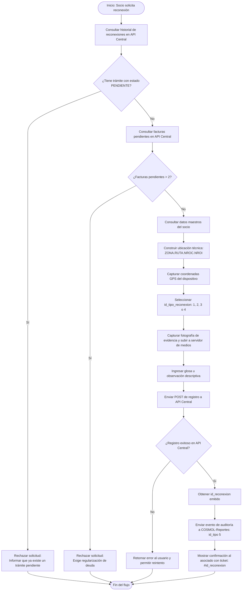

# Especificación Técnica: Módulo de Reconexión de Servicios — COSMOL

> **Documento de Arquitectura y Especificación de APIs**  
> **Propósito:** Guía de referencia técnica para recrear el módulo de reconexión en nuevas aplicaciones (móviles, web o microservicios) reutilizando las mismas APIs y reglas de negocio del sistema central de COSMOL.  
> **Restricción de formato:** Este documento describe la lógica mediante especificaciones HTTP, esquemas JSON y diagramas de arquitectura (sin código PHP).

---

## 1. Resumen y Propósito del Módulo

El **Módulo de Reconexión** permite a los asociados de COSMOL solicitar la reactivación de su servicio de agua potable y/o alcantarillado luego de un corte o suspensión del suministro.

Para que una solicitud sea aceptada y procesada por las brigadas técnicas de COSMOL, el sistema debe garantizar que el socio cumpla con las políticas comerciales de la cooperativa (no exceder el límite de morosidad ni tener solicitudes previas en curso) y recopilar datos técnicos indispensables de geolocalización e inspección visual.

---

## 2. Reglas de Negocio y Pre-condiciones

Antes de autorizar y registrar cualquier solicitud de reconexión, la aplicación cliente **debe** evaluar las siguientes reglas en orden secuencial:

### Regla 1: Verificación de Trámites Previos (No duplicidad)
* **Objetivo:** Evitar que un asociado genere múltiples órdenes de trabajo activas para un mismo medidor.
* **Criterio:** Consultar el historial de reconexiones del socio. Si existe al menos un trámite con estado `PENDIENTE`, la solicitud actual se **rechaza**.
* **Acción requerida:** Notificar al asociado que ya cuenta con una solicitud en proceso y que su caso está en cola de atención técnica.

### Regla 2: Límite de Morosidad (Máximo 2 meses de deuda)
* **Objetivo:** Cumplir la normativa comercial de COSMOL que restringe reconexiones a socios con alta mora.
* **Criterio:** Consultar el listado de facturas pendientes de pago. Se cuenta el número de facturas adeudadas (`cantidad_facturas`).
* **Condición de bloqueo:** Si `cantidad_facturas > 2`, la solicitud se **bloquea inmediatamente**.
* **Acción requerida:** Indicar al asociado la cantidad de facturas adeudadas y requerir la regularización de pagos (vía pasarela Multipago o cajas) antes de reintentar el trámite.

### Regla 3: Resolución de la Ubicación Técnica Catastral
* **Objetivo:** Identificar la coordenada catastral de red del asociado en el sistema central de distribución.
* **Criterio:** Consultar los datos maestros del socio y extraer:
  * `ZONA` (Zona geográfica/comercial)
  * `RUTA` (Ruta de lectura y distribución)
  * `NROC` (Número de casa o conexión)
  * `NROI` (Número de orden interno o departamento)
* **Formateo de Ubicación:** Se debe estructurar la cadena compuesta con la sintaxis:  
  `{ZONA}.{RUTA}.{NROC}.{NROI}` (Ejemplo: `"1.4.120.0"`).

### Regla 4: Captura Obligatoria de Datos de Campo
* Debido a que no todas las conexiones cuentan con nomenclatura domiciliaria exacta en Montero, el registro requiere obligatoriamente:
  1. **Coordenadas GPS:** Latitud y longitud con formato numérico `"latitud, longitud"`.
  2. **Tipo de Reconexión:** Identificador numérico del motivo de la reconexión.
  3. **Fotografía de Evidencia:** Archivo de imagen del medidor o de la caja de acometida. Debe subirse a un servidor de medios para obtener una URL accesible.
  4. **Glosa u Observación:** Texto descriptivo con referencias físicas del domicilio (ej. color de rejas, árbol visible, frente a comercio).
  5. **Usuario de Registro:** Identificador numérico del sistema o canal emisor (en sistemas automatizados se utiliza el identificador `2`).

### Regla 5: Registro de Auditoría y Métricas (COSMOL-Reportes)
* Tras el registro exitoso del trámite en la API central, la aplicación debe notificar al sistema de analítica y métricas (`COSMOL-Reportes`) bajo el tipo de evento correspondiente (`id_tipo: 5` - "Solicitud de Reconexión").

---

## 3. Catálogo de Tipos y Estados de Reconexión

### 3.1 Tipos de Reconexión (`id_tipo_reconexion`)

| `id_tipo_reconexion` | Nombre del Tipo | Descripción | Cuándo se utiliza |
|:---:|---|---|---|
| **1** | Corte normal | Sin retiro de medidor | El servicio fue cerrado mediante precinto o llave de paso, manteniendo el medidor instalado. |
| **2** | Con medidor | Retiro de medidor | El medidor fue retirado por mora prolongada o mantenimiento; se requiere reponer el instrumento de medición. |
| **3** | Con material | Falta de accesorios | La acometida sufrió corte físico de tubería, requiriendo niples, cuplas o accesorios de plomería para su restablecimiento. |
| **4** | Otros | Otro motivo | Casos especiales, reconexiones judiciales o inspecciones extraordinarias. |

### 3.2 Estados del Trámite

| Estado | Significado en el Sistema Central |
|---|---|
| `PENDIENTE` | La orden fue registrada exitosamente y está asignada a la cola de trabajo de los plomeros/técnicos. |
| `EN_PROCESO` | Una cuadrilla técnica ha tomado la orden de trabajo para su ejecución en campo. |
| `FINALIZADO` / `EJECUTADO` | El suministro fue reactivado en el domicilio del asociado. |
| `ANULADO` / `RECHAZADO` | La orden fue cancelada por insolvencia, datos erróneos o desistimiento. |

---

## 4. Diagrama del Flujo de Ejecución



---

## 5. Especificación de Endpoints y APIs

El módulo interactúa con dos subsistemas backend:
1. **API Central COSMOL (Sistema SAI / Informix):** Gestiona los datos de los socios, las deudas y las órdenes de trabajo.
2. **API COSMOL-Reportes:** Centraliza las auditorías, métricas y reportes operativos.

---

### 5.1 API Central de COSMOL (Sistema SAI)

* **Variable de configuración base:** `COSMOL_API_URL` (Ej: `http://api.cosmol.com.bo`)
* **Cabecera común para todas las peticiones:**
  ```http
  Accept: application/json
  Content-Type: application/json
  ```

---

#### Endpoint 5.1.1: Consultar Historial de Reconexiones (Validación de Trámites Previos)

Verifica si el socio tiene trámites de reconexión activos o registrados con anterioridad.

* **Método HTTP:** `GET`
* **Ruta:** `/api-consultas/socios/{codigo_socio}/reconexiones`
* **Parámetros de Ruta:**
  * `codigo_socio` *(string / int, requerido)*: Código fijo del socio (ej. `"267657"`).

##### Respuesta Exitosa (HTTP 200 OK):
```json
{
  "estado": "exito",
  "datos": [
    {
      "id_reconexion": 1284,
      "fecha": "2026-10-15 09:30:00",
      "tipo": "Corte normal",
      "estado": "PENDIENTE",
      "glosa": "Portón blanco, al lado de la tienda"
    }
  ]
}
```

##### Criterio de validación en la aplicación:
Iterar el arreglo `datos`. Si algún elemento tiene `estado == "PENDIENTE"` (ignorando mayúsculas/minúsculas y espacios), bloquear el flujo.

---

#### Endpoint 5.1.2: Consultar Deudas y Facturas Pendientes (Validación de Morosidad)

Obtiene el listado de facturas impagas para calcular el número de periodos adeudados y el monto total acumulado.

* **Método HTTP:** `GET`
* **Ruta:** `/api-consultas/socios/{codigo_socio}/deudas`
* **Parámetros de Ruta:**
  * `codigo_socio` *(string / int, requerido)*: Código fijo del socio.

##### Respuesta Exitosa con Facturas Pendientes (HTTP 200 OK):
```json
{
  "estado": "exito",
  "datos": [
    {
      "NROFACTURA": "748392",
      "NMES": 8,
      "ANIO": 2026,
      "MONTOTOTAL": 68.40,
      "RAZONSOCIAL": "JUAN PEREZ"
    },
    {
      "NROFACTURA": "759102",
      "NMES": 9,
      "ANIO": 2026,
      "MONTOTOTAL": 72.50,
      "RAZONSOCIAL": "JUAN PEREZ"
    }
  ]
}
```

##### Respuesta cuando el socio está al día (HTTP 200 OK):
```json
{
  "estado": "exito",
  "datos": []
}
```

##### Criterio de validación en la aplicación:
1. Si `datos` es un objeto individual (no un arreglo), envolverlo en una lista de 1 elemento.
2. Contar la cantidad de registros (`total_facturas = length(datos)`).
3. Si `total_facturas > 2`, abortar el trámite e informar al asociado.

---

#### Endpoint 5.1.3: Consultar Datos del Socio (Extracción Catastral)

Recupera los datos del abonado para construir la ubicación técnica de red requerida por las brigadas operativas.

* **Método HTTP:** `GET`
* **Ruta:** `/api-consultas/socios/{codigo_socio}`
* **Parámetros de Ruta:**
  * `codigo_socio` *(string / int, requerido)*: Código fijo del socio.

##### Respuesta Exitosa (HTTP 200 OK):
```json
{
  "estado": "exito",
  "datos": {
    "CODIGO": "267657",
    "NOMBRE": "JUAN PEREZ GUTIERREZ",
    "DIRECCION": "BARRIO CENTRAL C/ BOLIVAR #120",
    "ZONA": "1",
    "RUTA": "4",
    "NROC": "120",
    "NROI": "0"
  }
}
```

##### Construcción requerida del campo `ubicacion`:
* `zona`: `datos.ZONA` (convertido a entero para el payload, ej: `1`).
* `ruta`: `datos.RUTA` (convertido a entero para el payload, ej: `4`).
* `ubicacion`: Cadena concatenada con separador punto:  
  `"{datos.ZONA}.{datos.RUTA}.{datos.NROC}.{datos.NROI}"` $\rightarrow$ `"1.4.120.0"`.

---

#### Endpoint 5.1.4: Registrar Solicitud de Reconexión

Genera la orden de trabajo formal en el sistema central de COSMOL.

* **Método HTTP:** `POST`
* **Ruta:** `/api-consultas/socios/{codigo_socio}/reconexion`
* **Parámetros de Ruta:**
  * `codigo_socio` *(string / int, requerido)*: Código fijo del socio.
* **Cabeceras:**
  * `Content-Type: application/json`

##### Cuerpo de la Solicitud (Request Body JSON):

```json
{
  "usuario_registro": 2,
  "coordenadas_gps": "-17.345678, -63.254123",
  "id_tipo_reconexion": 1,
  "ubicacion": "1.4.120.0",
  "zona": 1,
  "ruta": 4,
  "glosa": "Casa con rejas negras y portón café. Medidor en la acera derecha.",
  "foto": "https://servidor-archivos.cosmol.com/uploads/reconexiones/reconexion_267657_1724300000.jpg"
}
```

##### Especificación de Campos del Payload:

| Campo | Tipo | Requerido | Descripción / Regla |
|---|:---:|:---:|---|
| `usuario_registro` | `integer` | Sí | Identificador del operador o sistema que registra la orden. Valor fijo: `2` para registros automatizados (bots/apps). |
| `coordenadas_gps` | `string` | Sí | Coordenadas en formato `"latitud, longitud"`. Ejemplo: `"-17.345678, -63.254123"`. |
| `id_tipo_reconexion` | `integer` | Sí | Valor del catálogo: `1` (Corte normal), `2` (Con medidor), `3` (Con material), `4` (Otros). |
| `ubicacion` | `string` | Sí | Ubicación técnica compuesta: `"{ZONA}.{RUTA}.{NROC}.{NROI}"`. |
| `zona` | `integer` | Sí | Valor numérico de la zona comercial/técnica extraída del socio. |
| `ruta` | `integer` | Sí | Valor numérico de la ruta técnica extraída del socio. |
| `glosa` | `string` | Sí | Descripción, referencias del inmueble o detalles del reclamo ingresados por el usuario. |
| `foto` | `string` | No / Opcional | URL pública o ruta del archivo de imagen subido al servidor de almacenamiento. |

##### Respuesta Exitosa (HTTP 200 OK / 201 Created):
```json
{
  "estado": "exito",
  "datos": {
    "id_reconexion": 4921,
    "estado": "PENDIENTE",
    "facturas_pendientes": 1
  }
}
```

##### Respuesta ante Error de Negocio o Validación (HTTP 400 Bad Request):
```json
{
  "estado": "error",
  "mensaje": "El socio cuenta con más de dos meses de deuda registrados en el sistema comercial."
}
```

---

### 5.2 API de Auditoría y Métricas (COSMOL-Reportes)

Permite registrar el evento de consulta y trámite en el panel de control administrativo y auditoría de COSMOL.

* **Variable de configuración base:** `REPORTES_API_URL`
* **Token de autenticación:** `REPORTES_API_TOKEN`

#### Endpoint 5.2.1: Enviar Registro de Auditoría

* **Método HTTP:** `POST`
* **Ruta:** `/api/consultas`
* **Cabeceras:**
  ```http
  Content-Type: application/json
  X-Reportes-Token: <valor_de_REPORTES_API_TOKEN>
  ```

##### Cuerpo de la Solicitud (Request Body JSON):
```json
{
  "codigo_socio": 267657,
  "nombres": "JUAN PEREZ GUTIERREZ",
  "id_tipo": 5,
  "tipo_consulta": "Solicitud de Reconexión",
  "fecha_consulta": "2026-10-28",
  "hora_consulta": "16:20:15"
}
```

##### Especificación de Campos:
* `codigo_socio` (`integer`): Código fijo del socio.
* `nombres` (`string`): Nombre completo del socio (o `"Socio #<codigo>"` si no está disponible).
* `id_tipo` (`integer`): **`5`** (Identificador estandarizado de "Solicitud de Reconexión" en el catálogo de consultas).
* `tipo_consulta` (`string`): Texto `"Solicitud de Reconexión"`.
* `fecha_consulta` (`string`): Fecha local en formato `YYYY-MM-DD`.
* `hora_consulta` (`string`): Hora local en formato `HH:mm:ss`.

##### Respuesta Exitosa (HTTP 200 OK / 201 Created):
```json
{
  "status": "success",
  "message": "Consulta registrada exitosamente",
  "id_consulta": 834
}
```

> [!TIP]
> **Recomendación de Resiliencia:** El envío de auditoría a `COSMOL-Reportes` debe configurarse con un timeout corto (1 a 2 segundos) y en modo no bloqueante o con cola local de reintentos (buffer) para que una eventual caída del servidor de reportes no interrumpa la respuesta final al usuario.

---

## 6. Manejo de Archivos Multimedia (Fotografías)

Para el envío del campo `foto` en la solicitud de reconexión:

1. **Captura:** La aplicación móvil/web debe solicitar una fotografía clara del medidor, de la acometida o de la fachada del inmueble.
2. **Subida a Servidor:** La imagen capturada en formato JPEG/PNG debe enviarse previamente a un endpoint de subida (storage, S3 o servidor web estático).
3. **Nomenclatura sugerida:**  
   `reconexion_{codigo_socio}_{timestamp}_{id_aleatorio}.jpg`
4. **Almacenamiento:** El endpoint de subida debe retornar la URL pública accesible (ejemplo: `https://dominio.com/uploads/reconexiones/reconexion_267657_1724300000.jpg`), la cual se asigna directamente al campo `"foto"` del JSON que se enviará a la API Central.

---

## 7. Matriz de Respuestas y Manejo de Errores

| Escenario | Condición Técnica | Código HTTP / Estado | Mensaje / Acción para el Usuario |
|---|---|:---:|---|
| **Trámite ya existente** | Historial contiene un elemento con `estado: "PENDIENTE"`. | 200 OK en historial | "Actualmente ya cuenta con una solicitud de reconexión en estado PENDIENTE. Nuestro equipo técnico atenderá su solicitud en la brevedad." |
| **Morosidad superior a 2 facturas** | `count(facturas_pendientes) > 2` | 200 OK en deudas | "Lo sentimos, no puede solicitar una reconexión porque tiene {N} facturas pendientes. Por favor regularice su pago antes de realizar este trámite." |
| **Socio no encontrado** | Código fijo inválido o no existente en SAI. | 404 Not Found o datos vacíos | "No se encontró ningún asociado registrado con el código ingresado. Verifique el número de código fijo de su factura." |
| **Fallo en API Central** | Error 500, timeout o caída de la API central. | 500 / Timeout | "El sistema central de COSMOL no se encuentra disponible temporalmente. Por favor, intente nuevamente en unos minutos." |
| **Registro exitoso** | API Central retorna `id_reconexion`. | 200 / 201 | "✅ Solicitud de Reconexión registrada exitosamente. Su número de ticket es: #{id_reconexion}." |

---

## 8. Checklist para Implementar en la Nueva Aplicación

Al recrear este módulo en cualquier plataforma o lenguaje, asegúrate de implementar los siguientes pasos:

- [ ] **Paso 1 (Autenticación / Identificación):** Obtener y validar el `codigo_socio` del cliente.
- [ ] **Paso 2 (Pre-validación 1 - Duplicidad):** Ejecutar `GET /api-consultas/socios/{codigo_socio}/reconexiones` y verificar que no exista ninguna orden en estado `"PENDIENTE"`.
- [ ] **Paso 3 (Pre-validación 2 - Deuda):** Ejecutar `GET /api-consultas/socios/{codigo_socio}/deudas` y verificar que la cantidad de facturas impagas sea menor o igual a 2.
- [ ] **Paso 4 (Consulta de datos técnicos):** Ejecutar `GET /api-consultas/socios/{codigo_socio}` para obtener los valores de `ZONA`, `RUTA`, `NROC` y `NROI`.
- [ ] **Paso 5 (Formulario / Captura en cliente):**
  - Obtener coordenadas GPS del dispositivo móvil/navegador (`latitud, longitud`).
  - Ofrecer selector de tipo de reconexión (`1=Corte normal`, `2=Con medidor`, `3=Con material`, `4=Otros`).
  - Capturar imagen de la cámara/galería y subirla para obtener la URL.
  - Solicitar descripción o glosa de referencia.
- [ ] **Paso 6 (Envío de orden a API Central):** Construir el JSON con `usuario_registro: 2`, `ubicacion: "ZONA.RUTA.NROC.NROI"` y los datos recopilados; enviar el `POST` a `/api-consultas/socios/{codigo_socio}/reconexion`.
- [ ] **Paso 7 (Auditoría en COSMOL-Reportes):** Enviar en segundo plano el `POST` a `/api/consultas` con `id_tipo: 5` y el nombre del asociado.
- [ ] **Paso 8 (Confirmación):** Entregar al usuario la pantalla o mensaje final de éxito con el número de ticket (`id_reconexion`) asignado.

