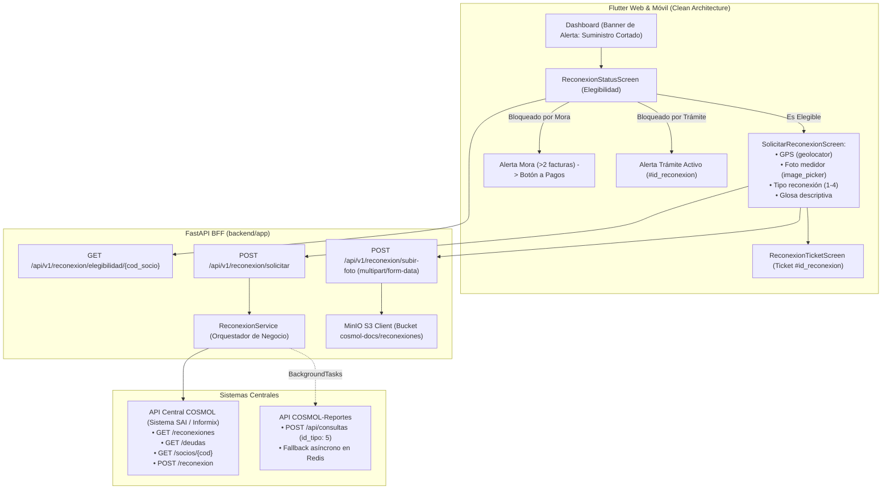
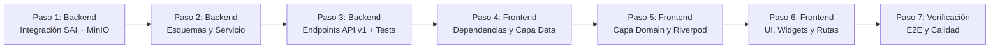

# Plan Maestro de Implementación — Módulo de Reconexión de Servicios
**COSMOL R.L. — Cooperativa de Servicios Públicos Montero R.L.**

> **Documento de Control y Seguimiento Técnico**  
> **Referencia Funcional:** [`Docs/pendiente/fabian/Modulo_reconexion.md`](./Modulo_reconexion.md)  
> **Gobernanza Arquitectónica:** [`AGENTS.md`](../../../AGENTS.md)  
> **Fecha de Creación:** Octubre 2026  
> **Estado:** Aprobado para desarrollo controlado  

---

## 1. Resumen Ejecutivo y Objetivos

El **Módulo de Reconexión de Servicios** permite a los asociados de COSMOL R.L. solicitar la reactivación formal de su suministro de agua potable y/o alcantarillado tras un corte o suspensión del servicio.

### Objetivos Clave:
1. **Validación Automática de Políticas:** Asegurar de forma desatendida que el socio no tenga trámites duplicados (`PENDIENTE`) y no supere el umbral máximo de morosidad (máximo 2 facturas adeudadas).
2. **Captura Fidedigna de Datos de Campo:** Recopilar geolocalización GPS (`latitud, longitud`), fotografía de evidencia de la acometida/medidor y glosa descriptiva de referencias físicas en Montero.
3. **Cero Exposición y Cero CORS:** Toda la interacción pasa a través del Backend BFF (FastAPI), que custodia las credenciales de MinIO (S3), orquesta las llamadas al sistema central SAI y despacha eventos de auditoría hacia `COSMOL-Reportes`.
4. **Experiencia Omnicanal (Web y Móvil):** La aplicación Flutter Web / Móvil utiliza un componente adaptativo para la selección/captura de la foto (Explorador de archivos en Web; Cámara o Galería en Móvil).

---

## 2. Decisiones Técnicas y Arquitectura

### Reglas de Negocio a Implementar (Obligatorias):
* **Regla 1 (No duplicidad):** Consultar `GET /api-consultas/socios/{codigo_socio}/reconexiones`. Si existe un registro con `estado == "PENDIENTE"`, la solicitud se bloquea y se muestra el ticket activo.
* **Regla 2 (Límite de Morosidad):** Consultar `GET /api-consultas/socios/{codigo_socio}/deudas`. Si `cantidad_facturas > 2`, la solicitud se bloquea inmediatamente y se redirige a pago.
* **Regla 3 (Ubicación Técnica Catastral):** Consultar `GET /api-consultas/socios/{codigo_socio}` y concatenar `{ZONA}.{RUTA}.{NROC}.{NROI}` (ej: `"1.4.120.0"`).
* **Regla 4 (Captura de Campo):**
  - GPS: Coordenadas `"latitud, longitud"`.
  - Tipo de reconexión: Catálogo numérico `1` (Corte normal), `2` (Con medidor), `3` (Con material), `4` (Otros).
  - Fotografía: Archivo subido a MinIO mediante el BFF para obtener URL pública.
  - Glosa: Descripción y referencias del domicilio.
  - `usuario_registro: 2` (identificador fijo para canales automatizados/app).
* **Regla 5 (Auditoría):** Enviar evento asíncrono a `COSMOL-Reportes` (`id_tipo: 5`, tipo_consulta: "Solicitud de Reconexión") con respaldo en Redis.

---

## 3. Hoja de Ruta de Implementación Paso a Paso

---

### 🔹 Paso 1: Backend — Adaptadores de Infraestructura (SAI y MinIO)
* **Objetivo:** Ampliar los clientes existentes en `backend/app/integrations/` para dar soporte a las operaciones de reconexión y almacenamiento de fotografías.
* **Tareas específicas:**
  1. **Actualizar `backend/app/integrations/cosmol_client.py`:**
     - Implementar `obtener_reconexiones_socio(self, cod_socio: str) -> List[Dict[str, Any]]`:
       - Petición HTTP asíncrona: `GET {COSMOL_API_URL}/api-consultas/socios/{cod_socio}/reconexiones`.
       - Normalización de respuesta y manejo de listas vacías o estados de error.
     - Implementar `registrar_solicitud_reconexion(self, cod_socio: str, payload: Dict[str, Any]) -> Dict[str, Any]`:
       - Petición HTTP asíncrona: `POST {COSMOL_API_URL}/api-consultas/socios/{cod_socio}/reconexion`.
       - Envío de cabecera `Content-Type: application/json`.
       - Captura de `id_reconexion` emitido o propagación de error de negocio (400 Bad Request).
  2. **Actualizar `backend/app/integrations/minio_client.py`:**
     - Implementar `subir_foto_evidencia_reconexion(self, cod_socio: str, contenido: bytes, extension: str = "jpg") -> str`:
       - Generar nombre normalizado: `reconexion_{cod_socio}_{timestamp}_{uuid}.jpg`.
       - Subir al bucket configurado bajo el prefijo `reconexiones/`.
       - Retornar la URL pública accesible para el campo `"foto"` del JSON central.
* **Criterio de Aceptación del Paso 1:** Métodos probados con sintaxis correcta, manejo de excepciones y timeouts controlados.

---

### 🔹 Paso 2: Backend — Esquemas Pydantic y Capa de Negocio (`ReconexionService`)
* **Objetivo:** Implementar la lógica pura de negocio desacoplada, validando de forma rigurosa las 5 reglas antes de tocar la base de datos o el sistema central.
* **Tareas específicas:**
  1. **Crear `backend/app/schemas/reconexion.py`:**
     - `TipoReconexionEnum`: `1: CORTE_NORMAL`, `2: CON_MEDIDOR`, `3: CON_MATERIAL`, `4: OTROS`.
     - `ReconexionHistorialItem`: Modelo de trámites previos (`id_reconexion`, `fecha`, `tipo`, `estado`, `glosa`).
     - `ElegibilidadReconexionResponse`:
       - `es_elegible: bool`
       - `motivo_bloqueo: Optional[str]` (ej: `"ALTA_MOROSIDAD"`, `"TRAMITE_DUPLICADO"`)
       - `mensaje_usuario: str`
       - `facturas_pendientes: int`
       - `tramite_pendiente_id: Optional[int]`
       - `ubicacion_catastral: Optional[str]`
     - `CrearReconexionRequest`:
       - `id_tipo_reconexion: int` (1 al 4)
       - `coordenadas_gps: str` (Regex de latitud, longitud)
       - `glosa: str` (Descripción de referencia física)
       - `foto_url: Optional[str]`
     - `CrearReconexionResponse`:
       - `id_reconexion: int`
       - `estado: str`
       - `mensaje: str`
  2. **Crear `backend/app/services/servicio_reconexion.py`:**
     - Inyectar `CosmolApiClient`, `CosmolMinioClient` y dependencias de auditoría.
     - Método `verificar_elegibilidad(cod_socio: str)`:
       - Ejecutar en paralelo o secuencial: `obtener_reconexiones_socio` y `obtener_deudas_socio`.
       - Evaluar Regla 1 (si hay `PENDIENTE`, bloquear).
       - Evaluar Regla 2 (si `total_facturas > 2`, bloquear).
       - Si es elegible, consultar `obtener_datos_socio` y construir `ubicacion` (`{ZONA}.{RUTA}.{NROC}.{NROI}`).
     - Método `solicitar_reconexion(cod_socio: str, datos: CrearReconexionRequest, background_tasks: BackgroundTasks)`:
       - Revalidar elegibilidad.
       - Construir el payload completo para SAI con `usuario_registro: 2`.
       - Llamar a `cosmol_client.registrar_solicitud_reconexion`.
       - Despachar en `background_tasks` la auditoría hacia `COSMOL-Reportes` (`id_tipo: 5`).
* **Criterio de Aceptación del Paso 2:** Pruebas unitarias de las validaciones de negocio ejecutándose con éxito.

---

### 🔹 Paso 3: Backend — Endpoints REST en API v1 y Registro
* **Objetivo:** Exponer la interfaz HTTP protegida para consumo de la aplicación web y móvil.
* **Tareas específicas:**
  1. **Crear `backend/app/api/v1/reconexion.py`:**
     - `GET /api/v1/reconexion/elegibilidad/{codigo_socio}`: Retorna el estado de elegibilidad, facturas adeudadas y ubicación técnica.
     - `GET /api/v1/reconexion/historial/{codigo_socio}`: Retorna la lista histórica de órdenes de reconexión.
     - `POST /api/v1/reconexion/subir-foto`: Recibe un archivo `UploadFile` (`multipart/form-data`), valida extensión/tamaño, lo sube a MinIO y retorna la URL pública.
     - `POST /api/v1/reconexion/solicitar`: Recibe `CrearReconexionRequest`, procesa la orden y retorna el ticket asignado.
  2. **Modificar `backend/app/api/v1/router.py`:**
     - Registrar el router con prefijo `/reconexion` y tag `"Módulo de Reconexión de Servicios"`.
  3. **Verificación con Pytest:**
     - Crear `backend/tests/api/test_reconexion.py` y verificar códigos HTTP 200, 400 y respuestas estructuradas.
* **Criterio de Aceptación del Paso 3:** Endpoints documentados en Swagger `/docs` y tests pasando en verde.

---

### 🔹 Paso 4: Frontend — Dependencias y Capa Data (Clean Architecture)
* **Objetivo:** Preparar el proyecto Flutter con soporte nativo de cámara/archivos y geolocalización, creando la capa de datos de la nueva feature.
* **Tareas específicas:**
  1. **Actualizar `frontend/pubspec.yaml`:**
     - Añadir `image_picker: ^1.1.2`
     - Añadir `geolocator: ^12.0.0`
     - Ejecutar `flutter pub get`.
  2. **Crear estructura en `frontend/lib/features/reconexion/data/`:**
     - `models/elegibilidad_reconexion_model.dart` (mapeo JSON de respuesta de elegibilidad).
     - `models/reconexion_tramite_model.dart` (mapeo del historial de órdenes).
     - `datasources/reconexion_remote_datasource.dart`:
       - `checkElegibilidad(String codSocio)`
       - `getHistorial(String codSocio)`
       - `subirFotoEvidencia(Uint8List bytes, String filename)`
       - `solicitarReconexion(Map<String, dynamic> payload)`
     - `repositories/reconexion_repository_impl.dart`:
       - Implementación del contrato del repositorio convirtiendo modelos a entidades de dominio y manejando excepciones de red con `DioException`.
* **Criterio de Aceptación del Paso 4:** Capa de datos compilando sin errores de tipos.

---

### 🔹 Paso 5: Frontend — Capa Domain y Manejo de Estado (Riverpod)
* **Objetivo:** Aislar las reglas de negocio en casos de uso puros y construir el proveedor de estado reactivo para la UI.
* **Tareas específicas:**
  1. **Crear entidades en `frontend/lib/features/reconexion/domain/entities/`:**
     - `ElegibilidadReconexion.dart`
     - `ReconexionTramite.dart`
  2. **Crear casos de uso en `frontend/lib/features/reconexion/domain/usecases/`:**
     - `CheckElegibilidadReconexionUseCase`
     - `GetHistorialReconexionesUseCase`
     - `SolicitarReconexionUseCase`
     - `SubirFotoEvidenciaUseCase`
  3. **Crear `frontend/lib/features/reconexion/presentation/providers/reconexion_provider.dart`:**
     - Definir `ReconexionState` con estados:
       - `cargando`: Verificando elegibilidad.
       - `bloqueadoPorMora`: Conteo de facturas > 2 y monto adeudado.
       - `bloqueadoPorTramite`: Número de orden existente en estado PENDIENTE.
       - `formularioListo`: Socio autorizado para completar los campos.
       - `subiendoYRegistrando`: Proceso de envío en curso con spinner de carga.
       - `exito`: Emisión del ticket final `#id_reconexion`.
       - `error`: Mensaje amigable de fallo o timeout.
* **Criterio de Aceptación del Paso 5:** Proveedor reactivo con cobertura de todos los estados del flujo.

---

### 🔹 Paso 6: Frontend — Widgets Adaptativos, Pantallas y Enrutamiento
* **Objetivo:** Desarrollar una interfaz moderna y adaptada a la Web y Móvil siguiendo la paleta y componentes de COSMOL.
* **Tareas específicas:**
  1. **Componentes reutilizables (`features/reconexion/presentation/widgets/`):**
     - `gps_capture_card.dart`: Captura automática de GPS con `geolocator`, botón de refresco y vista de precisión/coordenadas.
     - `photo_evidence_picker.dart`: Selector adaptativo (abre el explorador de archivos en Web y cámara/galería en Móvil) con previsualización en miniatura y botón de eliminar/cambiar foto.
     - `tipo_reconexion_selector.dart`: Chips o tarjetas de selección para los 4 tipos de corte.
  2. **Pantallas (`features/reconexion/presentation/screens/`):**
     - `reconexion_status_screen.dart`:
       - Pantalla de bienvenida al trámite que evalúa la elegibilidad.
       - Si está bloqueado por mora: Muestra tarjeta roja con el número de facturas y botón directo a *"Ir a Pagar Deuda"*.
       - Si está bloqueado por trámite pendiente: Muestra tarjeta amarilla con el número de ticket y aviso de *"En cola de atención"*.
       - Si es elegible: Botón principal *"Comenzar Solicitud"*.
     - `solicitar_reconexion_screen.dart`:
       - Formulario guiado con: GPS, selector de tipo, foto de evidencia y glosa/referencias físicas.
     - `reconexion_ticket_screen.dart`:
       - Pantalla de éxito con icono de confirmación, número de ticket `#id_reconexion`, recomendaciones de atención de las cuadrillas y botón para volver al Dashboard.
  3. **Enrutamiento y Puntos de Entrada:**
     - En `frontend/lib/core/router/app_router.dart`: Registrar rutas `/reconexion`, `/reconexion/solicitar` y `/reconexion/ticket/:id`.
     - En `frontend/lib/features/home/presentation/screens/dashboard_screen.dart`: Añadir banner de alerta cuando el suministro activo esté cortado o en mora, con acceso directo al módulo.
* **Criterio de Aceptación del Paso 6:** UI fluida, responsiva en Web y móvil, sin desbordamientos visuales (overflow).

---

### 🔹 Paso 7: Pruebas de Integración y Verificación Final
* **Objetivo:** Garantizar la estabilidad completa del sistema.
* **Tareas específicas:**
  1. Ejecución de `pytest` en backend verificando todos los servicios.
  2. Ejecución de `flutter analyze` en frontend para certificar cero advertencias y cero errores de linter.
  3. Prueba de carga y subida de archivo en entorno Web.
* **Criterio de Aceptación del Paso 7:** Sistema operativo de punta a punta listo para despliegue.

---

## 4. Matriz de Errores y Acciones para el Usuario

| Escenario | Condición Técnica | Código HTTP | Acción / Mensaje UI |
|---|---|:---:|---|
| **Trámite ya existente** | Historial contiene orden con `estado: "PENDIENTE"`. | 200 OK | Mostrar tarjeta de advertencia con el ID de trámite y bloquear el formulario. |
| **Morosidad > 2 facturas** | `count(facturas_pendientes) > 2` | 200 OK | Bloquear formulario y mostrar botón destacado hacia el módulo de Deuda / Pagos QR. |
| **Socio sin coordenadas GPS** | Permiso denegado en navegador/móvil | Validación local | Notificar amigablemente la necesidad de habilitar la ubicación para guiar a la cuadrilla. |
| **Error en API Central SAI** | Timeout o error 500 en sistema central | 502 / 504 | Notificar que el sistema central está temporalmente saturado y ofrecer reintento. |
| **Registro exitoso** | API Central retorna `id_reconexion` | 200 / 201 | Redirigir a `ReconexionTicketScreen` con el número de orden asignado. |

